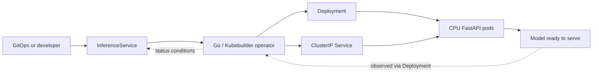

# AI Inference Kubernetes Operator

**Status: design stage; implementation has not started.** This repository currently contains documentation only. APIs, behaviours and workflows below are proposals, not working features. This is a portfolio and learning project, with no claim of production readiness or measured performance.

## Problem and intended users

Deploying an inference container requires more than starting a process: the model must load, become ready to serve, and remain observable during updates and failures. Repeating Deployment and Service configuration makes it easy for developers to apply inconsistent operational settings.

This project proposes an `InferenceService` custom resource through which application developers declare an inference workload. A Go operator built with Kubebuilder will translate that intent into Kubernetes resources. Platform engineers are the other intended users: they define the serving contract, reconciliation rules and operational feedback.

## Scope and learning objectives

The first version targets CPU workloads, one Python/FastAPI example service and one supported HTTP serving contract. It will demonstrate custom resource design, idempotent reconciliation, Kubernetes ownership, readiness and rollout reporting, least-privilege RBAC, and behaviour-focused testing on kind.

GPU scheduling, billing, a UI and automatic rollback are out of scope. The operator will not train models or manage model downloads as separate infrastructure. The initial workload will package its model with the container image.

## Proposed architecture



GitOps manages the custom resource; the operator manages its associated parts. See [architecture](docs/architecture.md) for the serving contract, ownership and status design.

## Proposed custom resource

This illustrative API is not installed or validated by a CRD yet. The image is a placeholder for a future workload build.

```yaml
apiVersion: inference.platform.example.com/v1alpha1
kind: InferenceService
metadata:
  name: text-classifier
  namespace: inference-demo
spec:
  image: example.invalid/inference-demo:v1
  replicas: 1
  resources:
    requests:
      cpu: 250m
      memory: 256Mi
    limits:
      cpu: "1"
      memory: 512Mi
```

The initial API will fix the serving port and health endpoints instead of supporting arbitrary serving frameworks. Image, replica count and CPU/memory resources will be configurable.

## Planned operator behaviour

- Create and reconcile one Deployment and one ClusterIP Service per `InferenceService`.
- Restore deleted owned resources and correct drift in fields the operator manages.
- Report readiness, rollout progress and rollout failures through status conditions tied to the observed resource generation.
- Apply image, replica and resource changes through Deployment updates; rely on Kubernetes rollout behaviour without automatic rollback.
- Set owner references so Kubernetes garbage collection cleans up children when the custom resource is deleted.

Reconciliation will be idempotent. Readiness will mean the model can serve requests, rather than merely that a process or HTTP server is running. Permissions will be namespace-scoped where practical.

## Phased implementation roadmap

1. **Scaffold and API:** initialize Go/Kubebuilder, define and validate the initial CRD, and document generated development commands.
2. **Serving contract:** build the small CPU FastAPI workload with inference and meaningful health endpoints.
3. **Core reconciliation:** manage Deployment and Service, handle updates and drift, recover deleted children, and establish ownership cleanup.
4. **Operational status:** expose generation-aware conditions and test model readiness and rollout failures.
5. **Local demonstration and verification:** complete kind workflows, automated failure scenarios and a reproducible portfolio walkthrough.

See the [roadmap](docs/roadmap.md) for milestone acceptance criteria. Each milestone will be implemented and verified before moving to the next.

## Planned local development and testing

Local development will use Go, Kubebuilder, a container build tool, kind, kubectl and Python tooling. A kind cluster will host the example workload and operator; locally built images will be made available to its nodes. Exact prerequisites, versions and setup commands will be documented after scaffolding exists.

Planned verification combines unit tests for decision logic, envtest for API validation and reconciliation against a real API server, and kind end-to-end tests for Deployment rollouts, probes, request serving and garbage collection. envtest does not run the Kubernetes Deployment controller, scheduler or kubelet, so it cannot establish workload readiness on its own.

Failure scenarios will include deleted children, image pull failures, a model that never becomes ready, invalid resources, conflicting ownership and updates during a rollout. Tests will assert observable resources and status, including recovery after failures are corrected.

The next implementation step is milestone 1: scaffold the Go/Kubebuilder project and turn the proposed API into a validated CRD.
